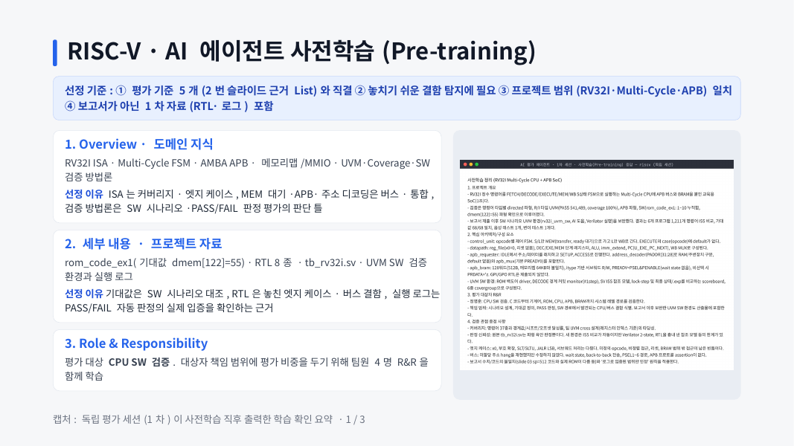
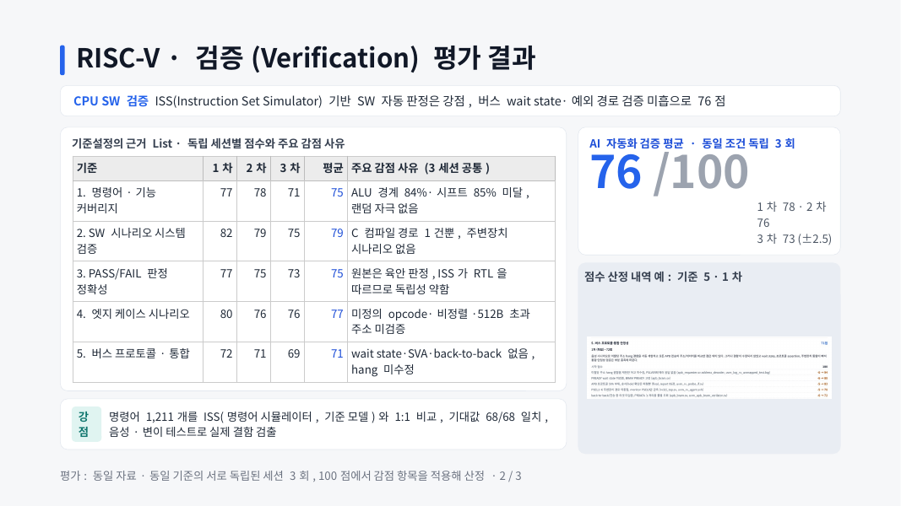
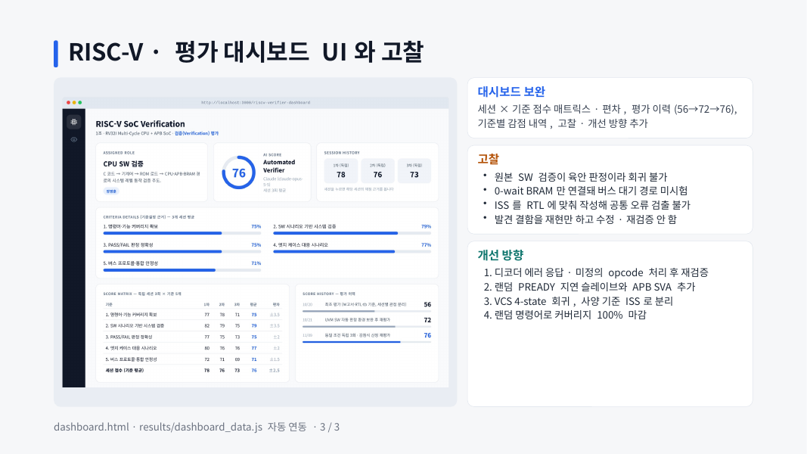

# AI 기반 프로젝트 설계·검증 자동 평가기 (Gemini)

| 프로젝트 | 평가 축 | 평가 대상 역할 |
|---|---|---|
| [RISC-V (1조) RV32I Multi-Cycle + APB](https://github.com/wjdaudgns120-max/RV32I_CPU_Project) | **검증(Verification)** | 정명훈 · CPU SW 검증 |
| [On-Device AI (6조) YOLO26s 출입 관리](https://github.com/wjdaudgns120-max/CNN_Team_Project) | **설계(Design)** | 정명훈 · 추론 알고리즘 구축 |

프로젝트마다 다음을 수행합니다.
**사전학습(배경지식 + 보고서 + 소스) → 5개 기준 채점(JSON) → 새 세션으로 3회 반복 → 평균 점수 → 대시보드**

> 📑 발표 자료: [docs/RISC-V_AI_Verification_Evaluation.pdf](docs/RISC-V_AI_Verification_Evaluation.pdf) · [원본 PPTX](docs/RISC-V_AI_Verification_Evaluation.pptx)

## 평가 결과 요약 (RISC-V · 검증)

**AI 자동화 검증 평균 76 / 100** (독립 세션 3회: 78 · 76 · 73, 평가 이력 56 → 72 → 76)

| 기준 | 1차 | 2차 | 3차 | 평균 | 주요 감점 사유 |
|---|---:|---:|---:|---:|---|
| 1. 명령어·기능 커버리지 | 77 | 78 | 71 | 75 | ALU 경계 84%, 시프트 85% 미달, 랜덤 자극 없음 |
| 2. SW 시나리오 시스템 검증 | 82 | 79 | 75 | 79 | C 컴파일 경로 1건뿐, 주변장치 시나리오 없음 |
| 3. PASS/FAIL 판정 정확성 | 77 | 75 | 73 | 75 | 원본은 육안 판정, ISS가 RTL을 따르므로 독립성 약함 |
| 4. 엣지 케이스 시나리오 | 80 | 76 | 76 | 77 | 미정의 opcode, 비정렬, 512B 초과 주소 미검증 |
| 5. 버스 프로토콜·통합 | 72 | 71 | 69 | 71 | wait state, SVA, back-to-back 없음, hang 미수정 |

- **강점**: 명령어 1,211개를 ISS(명령어 시뮬레이터, 기준 모델)와 1:1 비교, 기대값 68/68 일치, 음성·변이 테스트로 실제 결함 검출
- **고찰**: 원본 SW 검증이 육안 판정이라 회귀 불가 · 0-wait BRAM만 연결돼 버스 대기 경로 미시험 · ISS를 RTL에 맞춰 작성해 공통 오류 검출 불가 · 발견 결함을 재현만 하고 수정·재검증 안 함

| 사전학습 | 평가 결과 | 대시보드 · 고찰 |
|---|---|---|
|  |  |  |

---

## 1. 설치 (최초 1회)

```bash
pip install -r requirements.txt
```

> 가이드에 나온 `google-generativeai` / `gemini-1.5-flash` 는 구버전입니다.
> 이 도구는 Google 공식 신규 SDK인 `google-genai`(`from google import genai`)를 씁니다.

## 2. API 키 설정 (.env)

1. `.env.example` 파일을 복사해 이름을 `.env` 로 바꿉니다.
2. `GEMINI_API_KEY=` 뒤에 팀장에게 받은 키를 **따옴표 없이** 붙여 넣습니다.
3. `.gitignore` 에 `.env` 가 이미 들어 있습니다. 키를 코드에 직접 쓰거나 깃허브에 올리지 마세요.

## 3. 실행

```bash
# (선택) API 호출 없이 프롬프트만 확인 → results/dryrun_*.txt
python evaluator.py --project all --dry-run

# 실제 평가 (프로젝트별로 따로 돌리는 것을 권장)
python evaluator.py --project riscv
python evaluator.py --project ondevice
```

- 프로젝트 1개당 API 호출은 6회(세션 3회 × 사전학습/채점)이고, 약 1~3분 걸립니다.
- 팀 공용 한도를 보호하기 위해 429 오류가 나면 60초 대기 후 최대 3회까지만 재시도합니다. 무한 루프는 없습니다.
- 모델이 없다는 404 오류가 나면 `gemini-3.6-flash` → `gemini-2.5-flash` 순서로 자동 전환합니다. 직접 바꾸려면 `.env` 의 `GEMINI_MODEL` 을 수정하세요.

## 4. 결과 확인

- 터미널: 기준별·세션별 점수표와 최종 평균이 출력됩니다. **이 화면을 캡처하세요.**
- `dashboard.html` 을 더블클릭해 브라우저로 엽니다. 왼쪽 아이콘(칩 / 눈)으로 프로젝트를 전환합니다.
  - 세션 박스를 누르면 해당 세션의 기준별 점수와 근거·보완점이 표시됩니다.
- `results/latest_<프로젝트>.json`: 최종 결과(제출 근거 자료)
- `results/raw/`: Gemini 원본 응답(사전학습 요약, 채점 JSON)

## 5. 제출 슬라이드용 캡처 체크리스트 (프로젝트당 3장)

| 슬라이드 | 넣을 캡처 |
|---|---|
| ① Pre-training | `results/raw/*_s1_pretrain.md` 내용, 또는 대시보드 하단 "사전학습 응답" 펼친 화면 |
| ② Role · 기준설정 근거 · 결과 | 터미널 점수표 캡처 |
| ③ UI 구현 | `dashboard.html` 상단 화면(역할 / AI SCORE / 세션 / 기준 바) |

## 폴더 구조

```
evaluator.py              평가 실행 스크립트
dashboard.html            결과 대시보드 (results/dashboard_data.js 를 읽음)
projects/riscv/           config.json(기준·세션) / pretrain_knowledge.md / materials/(보고서·RTL)
projects/ondevice/        config.json / pretrain_knowledge.md / materials/(보고서·py 코드)
results/                  실행 결과 (자동 생성)
docs/                     발표 자료(PPTX·PDF)와 슬라이드 미리보기
```

기준이나 세션 관점을 바꾸려면 각 프로젝트의 `config.json` 을 수정하고, 배경지식을 보강하려면 `pretrain_knowledge.md` 를 수정하세요.
